<div dir="rtl">

<div align="center">

# دليل المبتدئين إلى Grok Bot

[中文](./README.md) · [English](./README.en.md) · [日本語](./README.ja.md) · [한국어](./README.ko.md) · [Español](./README.es.md) · [Português](./README.pt.md) · [Français](./README.fr.md) · [Deutsch](./README.de.md) · [Русский](./README.ru.md) · **العربية**

### استفد من Grok Bot إلى أقصى حد. والبداية من طريقة تفكيرك.

لدى poteto، من الفريق الذي يصنع Grok Bot في SpaceX، مقال طويل عن تسليم العمل إلى البوتات.<br>وهذا الدليل يحوّله إلى ثلاثة دروس قصيرة. اتبعها مرة واحدة، فيصير لديك بوت يؤدي عنك عملًا كل أسبوع.

**[ابدأ بالدرس 1 ←](https://grokbot.xiaoxiaodong.ai/ar/start/1-goal/)**　·　**[تستخدمه من قبل؟ الدليل الكامل (بالإنجليزية) ←](https://grokbot.xiaoxiaodong.ai/en/guide/0-what/)**

<sub>غير رسمي · مجاني · مفتوح المصدر · 10 لغات</sub>

</div>

<p align="center">
  
</p>

## ربما جرّبت هذا من قبل

صار عندك Grok Bot، فطلبت منه أن يبحث عن شيء أو يكتب بضعة أسطر، فأحسن. ثم جاء يوم الجمعة، وكنت ما زلت تنقّب في البريد وتنسخ الأرقام وتصنع الشرائح بنفسك.

المشكلة ليست في البوت. فالذكاء الاصطناعي في المحادثة يعطيك ردًّا ويترك الباقي عليك. أما البوت في Grok Bot فلديه كمبيوتر في السحابة: يستطيع أن يفتح التطبيقات، ويتصفّح المواقع، ويرتّب الملفات، ويبدأ حسب جدول، فيستطيع فعلًا أن ينهي العمل. الناقص شيء واحد: أن تعرف كيف تسلّمه العمل.

<p align="center">
  
</p>

## السر كله في فطيرة تفاح

يبدأ مقال poteto بفكرة أن الأتمتة في الحقيقة طريقة تفكير، ويستطيع أي أحد أن يتعلّمها. ولها جزآن: هدف، وطريقة.

حين تخبز فطيرة تفاح، فالفطيرة هي الهدف. أما شراء التفاح، وعجن العجين، والتجميع، والخَبز، والتبريد، فهي الطريقة. ومعظم الناس يسلّمون البوت خطوة واحدة من الطريقة، مثل «أرسل هذا البريد»، فلا يفعل البوت إلا إرسال البريد. لكن أخبره عن الفطيرة أولًا، فيستطيع أن يتولّى الطريقة كلها، وربما يجد طريقًا أسهل.

<p align="center">
  
</p>

## ثلاثة دروس، شيء واحد كل مرة

لا تحتاج إلى كتابة الكود ولا إلى حفظ كومة من المصطلحات أولًا. كل درس يفعل شيئًا واحدًا، وتخرج منه بشيء جديد.

<p align="center">
  
</p>

1. **[اكتب جملة واحدة](https://grokbot.xiaoxiaodong.ai/ar/start/1-goal/)**: اختر شيئًا تفعله كثيرًا، واكتب النتيجة التي تريدها حقًا.
2. **[اصنع Potato](https://grokbot.xiaoxiaodong.ai/ar/start/2-first-bot/)**: ثبّت Grok Bot، واصنع بوتًا، وأعطه تلك الجملة.
3. **[سلّمه عملًا](https://grokbot.xiaoxiaodong.ai/ar/start/3-hand-over/)**: اشرح له كيف تؤدي العمل، وشاهده يصيب فيه مرة، ثم دعه يعمل كل أسبوع.

## لا تستطيع الانتظار؟ جرّب رسالة واحدة الآن

ثبّت Grok Bot من [x.ai/bot](https://x.ai/bot) (تحتاج إلى باقة تشمله، مثل Premium أو Super أو Ultra في The X Subscription)، واختر **+** (**Bot جديد**) في أعلى الشريط الجانبي، وسمِّه `Potato`، ثم أرسل:

```text
مرحبًا Potato، هذا هو الهدف الذي أريدك أن تكون مسؤولًا عنه. تذكّره من فضلك:
أريد أن تكون بين أيدي الجميع قبل اجتماع الاثنين شرائح عن تقدّم هذا الأسبوع، حتى نقضي وقتًا أقل في قراءة الأرقام بصوت عالٍ ووقتًا أكثر في اتخاذ القرار.
بناءً على هذا الهدف، اختر لنفسك اسمًا وصورة.
```

ضع عملك أنت مكان السطر الأوسط. ولتشرح له كيف تؤدي العمل، راجع [الدرس 3](https://grokbot.xiaoxiaodong.ai/ar/start/3-hand-over/).

## تستخدمه من قبل؟

- **[الدليل الكامل](https://grokbot.xiaoxiaodong.ai/en/guide/0-what/)** (بالإنجليزية): ثماني خطوات تتعمّق أكثر مع مقال poteto: علّمه كيف تقرّر، واربط تطبيقاتك، ودعه يتعلّم من الملاحظات، ويعمل حسب جدول، ووزّع العمل على فريق من البوتات.
- **[How-to](https://grokbot.xiaoxiaodong.ai/en/howto/)** (بالإنجليزية): 15 عملًا حقيقيًا، من الملخص الصباحي وصندوق بريدك وحجوزات العملاء إلى التقييمات وملخصات الاجتماعات، ومعها ما ينبغي أن يسألك عنه أولًا، وكيف تسلّمه بيانات دخولك، وكيف يُحسب الاستخدام.
- **[Wiki](https://grokbot.xiaoxiaodong.ai/en/wiki/)** و **[الأسئلة الشائعة](https://grokbot.xiaoxiaodong.ai/en/faq/)** (بالإنجليزية): لكلمة لا تعرفها، أو سؤال لست متأكدًا من جوابه.

## من أين يأتي هذا

يتبع الدليل مقال [poteto](https://x.com/poteto) بعنوان [Automate Anything with Grok Bot](https://x.com/poteto/status/2123159537016533493). وpoteto من الفريق الذي يصنع Grok Bot في SpaceX، ومن فريق React Compiler الأساسي، وسبق لـ poteto العمل في Cursor. كل ميزة وزر وباقة روجعت على [التوثيق الرسمي لـ Grok Bot](https://docs.x.ai/grok-bot)، وأسماء الأزرار في صفحات كل لغة مطابقة لواجهة التطبيق بتلك اللغة.

هذا دليل غير رسمي، لا صلة له بـ xAI ولا SpaceX ولا Cursor، ولا يتحدث باسمها. وGrok Bot علامة تجارية لمالكها. الميزات والباقات تتغيّر، فالمرجع هو التوثيق الرسمي.

## التشغيل محليًا

</div>

```bash
npm install
npm run dev        # http://localhost:4430
npm run build      # output in dist/
```

<div dir="rtl">

قواعد الكتابة والمصادر والسكربت الذي يزامن التوثيق الرسمي موجودة في [docs/MAINTAINING.md](docs/MAINTAINING.md). وهيكل الموقع مأخوذ من [pstack Beginner's Guide](https://github.com/nevertoday/xxd-pstack)، مع Xiaoxiaodong UI Kit. والكود مرخّص بموجب MIT، راجع [LICENSE](LICENSE).

</div>
