<div align="center">

# Grok Bot für Einsteiger

[中文](./README.md) · [English](./README.en.md) · [日本語](./README.ja.md) · [한국어](./README.ko.md) · [Español](./README.es.md) · [Português](./README.pt.md) · [Français](./README.fr.md) · **Deutsch** · [Русский](./README.ru.md) · [العربية](./README.ar.md)

### Hol das Beste aus Grok Bot heraus. Es fängt damit an, wie du denkst.

Bei SpaceX entwickelt poteto Grok Bot und hat einen langen Beitrag darüber geschrieben, wie man Bots Arbeit übergibt.<br>Diese Anleitung macht daraus drei kurze Lektionen. Geh sie einmal durch, und ein Bot erledigt jede Woche eine Aufgabe für dich.

**[Mit Lektion 1 anfangen →](https://grokbot.xiaoxiaodong.ai/de/start/1-goal/)**　·　**[Schon dabei? Die vollständige Anleitung (Englisch) →](https://grokbot.xiaoxiaodong.ai/en/guide/0-what/)**

<sub>Inoffiziell · kostenlos · Open Source · 10 Sprachen</sub>

</div>

<p align="center">
  
</p>

## Das hast du wahrscheinlich schon probiert

Du hast Grok Bot installiert, ihn etwas nachschlagen oder ein paar Zeilen entwerfen lassen, und das hat gut geklappt. Dann kam der Freitag, und du hast wieder selbst E-Mails durchsucht, Zahlen kopiert und die Folien gebaut.

Am Bot liegt es nicht. Eine Chat-KI gibt dir eine Antwort und überlässt dir den Rest. Ein Bot in Grok Bot hat einen Computer in der Cloud: Er kann Apps öffnen, im Netz surfen, Dateien sortieren und nach Zeitplan loslegen, also kann er die Arbeit wirklich zu Ende bringen. Was fehlt, ist das Wissen, wie du ihm die Arbeit übergibst.

<p align="center">
  
</p>

## Der Trick passt in einen Apfelkuchen

Gleich am Anfang des Beitrags steht bei poteto, dass Automatisierung eigentlich eine Denkweise ist, die alle lernen können. Sie hat zwei Teile, ein Ziel und einen Ablauf.

Wenn du einen Apfelkuchen backst, ist der Kuchen das Ziel. Äpfel kaufen, den Teig machen, alles zusammensetzen, backen und abkühlen lassen, das ist der Ablauf. Die meisten geben einem Bot nur einen Schritt aus dem Ablauf, etwa „Schick diese E-Mail“, und dann schickt der Bot eben immer nur E-Mails. Erzähl ihm zuerst vom Kuchen, dann kann er den ganzen Ablauf übernehmen und findet vielleicht sogar einen einfacheren Weg.

<p align="center">
  
</p>

## Drei Lektionen, eine Sache nach der anderen

Du musst nicht programmieren und vorher keinen Haufen Begriffe lernen. Jede Lektion macht genau eine Sache, und danach hast du etwas Neues in der Hand.

<p align="center">
  
</p>

1. **[Einen Satz schreiben](https://grokbot.xiaoxiaodong.ai/de/start/1-goal/)**: Such dir etwas aus, das du oft machst, und schreib das Ergebnis auf, das du wirklich willst.
2. **[Potato erstellen](https://grokbot.xiaoxiaodong.ai/de/start/2-first-bot/)**: Installier Grok Bot, erstell einen Bot und gib ihm diesen Satz.
3. **[Eine Aufgabe übergeben](https://grokbot.xiaoxiaodong.ai/de/start/3-hand-over/)**: Erzähl ihm, wie du die Arbeit machst, schau zu, wie er sie einmal richtig erledigt, und lass ihn dann jede Woche laufen.

## Keine Geduld? Probier jetzt gleich eine Nachricht

Installier Grok Bot von [x.ai/bot](https://x.ai/bot) (du brauchst ein Abo, das es enthält, etwa Premium, Super oder Ultra bei The X Subscription), klick oben in der Seitenleiste auf **+** (**Neuer Bot**), nenn ihn `Potato` und schick:

```text
Hallo Potato, das ist das Ziel, um das du dich kümmern sollst. Bitte merk es dir:
Ich möchte, dass vor dem Montagsmeeting alle Folien zum Fortschritt der Woche haben, damit wir weniger Zeit mit dem Vorlesen von Zahlen verbringen und mehr Zeit zum Entscheiden haben.
Such dir passend zu diesem Ziel einen Namen und ein Bild aus.
```

Tausch die mittlere Zeile gegen deine eigene Aufgabe aus. Wie du ihm erzählst, wie du die Arbeit machst, steht in [Lektion 3](https://grokbot.xiaoxiaodong.ai/de/start/3-hand-over/).

## Du nutzt es schon?

- **[Die vollständige Anleitung](https://grokbot.xiaoxiaodong.ai/en/guide/0-what/)** (Englisch): acht Schritte, die entlang des Beitrags von poteto tiefer gehen. Du bringst ihm bei, wie du urteilst, verbindest deine Apps, lässt ihn aus Feedback lernen, lässt ihn nach Zeitplan laufen und verteilst die Arbeit auf ein Team von Bots.
- **[How-to](https://grokbot.xiaoxiaodong.ai/en/howto/)** (Englisch): 15 echte Aufgaben, etwa ein Briefing am Morgen, dein Posteingang, Kundentermine, Bewertungen oder Zusammenfassungen von Meetings. Dazu, was er dich zuerst fragen sollte, wie du ihm deine Zugangsdaten gibst und wie die Nutzung funktioniert.
- **[Wiki](https://grokbot.xiaoxiaodong.ai/en/wiki/)** und **[Häufige Fragen](https://grokbot.xiaoxiaodong.ai/en/faq/)** (Englisch): für ein Wort, das du nicht kennst, oder eine Frage, bei der du unsicher bist.

## Woher das kommt

Die Anleitung folgt dem Beitrag [Automate Anything with Grok Bot](https://x.com/poteto/status/2123159537016533493) von [poteto](https://x.com/poteto). poteto entwickelt Grok Bot bei SpaceX, war vorher bei Cursor und gehört zum Kernteam des React Compiler. Jede Funktion, jeder Button und jedes Abo ist mit der [offiziellen Doku von Grok Bot](https://docs.x.ai/grok-bot) abgeglichen; auf den deutschen Seiten stehen die Buttons so, wie die deutsche Oberfläche der App sie zeigt.

Das ist eine inoffizielle Anleitung ohne Verbindung zu xAI, SpaceX oder Cursor, und sie spricht nicht für diese Unternehmen. Grok Bot ist eine Marke ihres Inhabers. Funktionen und Abos ändern sich, deshalb ist die offizielle Doku maßgeblich.

## Lokal starten

```bash
npm install
npm run dev        # http://localhost:4430
npm run build      # Ausgabe in dist/
```

Schreibregeln, Quellen und das Skript, das die offizielle Doku synchronisiert, stehen in [docs/MAINTAINING.md](docs/MAINTAINING.md). Das Gerüst der Seite stammt aus der [pstack-Anleitung für Einsteiger](https://github.com/nevertoday/xxd-pstack), mit dem Xiaoxiaodong UI Kit. Der Code steht unter der MIT-Lizenz, siehe [LICENSE](LICENSE).
