<div align="center">

# Grok Bot for Beginners

[中文](./README.md) · **English**

### Get the most out of Grok Bot. It starts with how you think.

poteto, an engineer who builds Grok Bot at SpaceX, wrote a long post on handing work to bots.<br>This guide turns it into three short lessons. Follow along once, and you'll have a bot doing a job for you every week.

**[Start with lesson 1 →](https://grokbot.xiaoxiaodong.ai/en/start/1-goal/)**　·　**[Already using it? The full guide →](https://grokbot.xiaoxiaodong.ai/en/guide/0-what/)**

<sub>Unofficial · free · open source · English and Chinese</sub>

</div>

<p align="center">
  
</p>

## You've probably tried this already

You installed Grok Bot, asked it to look something up or draft a few lines, and it did fine. Then Friday came, and you were still digging through email, copying numbers and building the slides yourself.

The bot isn't the problem. A chat AI hands you a reply and leaves the rest to you. A bot in Grok Bot has a computer in the cloud: it can open apps, browse, sort files and start on a schedule, so it can actually finish the job. The missing piece is knowing how to hand the job over.

<p align="center">
  
</p>

## The trick fits in an apple pie

poteto opens the post by saying automation is really a way of thinking that anyone can learn. It has two parts: a goal and a process.

When you bake an apple pie, the pie is the goal. Buying apples, making the dough, assembling, baking and cooling are the process. Most people hand a bot one step of the process, like "send this email", so the bot only ever sends emails. Tell it about the pie first, and it can take over the whole process, and maybe find an easier way.

<p align="center">
  
</p>

## Three lessons, one thing at a time

You don't need to code or learn a pile of terms first. Each lesson does one thing, and you leave with something new.

<p align="center">
  
</p>

1. **[Write one sentence](https://grokbot.xiaoxiaodong.ai/en/start/1-goal/)**: pick something you do often and write down the result you really want.
2. **[Make Potato](https://grokbot.xiaoxiaodong.ai/en/start/2-first-bot/)**: install Grok Bot, make a bot and give it that sentence.
3. **[Hand over a job](https://grokbot.xiaoxiaodong.ai/en/start/3-hand-over/)**: talk it through how you do the job, watch it get it right once, then let it run every week.

## Can't wait? Try one message now

Install Grok Bot from [x.ai/bot](https://x.ai/bot) (you need a plan that includes it, such as Premium, Super or Ultra on The X Subscription), choose **+** (**New Bot**) at the top of the sidebar, name it `Potato`, and send:

```text
Hi Potato, here's the goal I want you to be responsible for. Please remember it:
I want everyone to have slides on this week's progress before Monday's meeting, so that we spend less time reading numbers aloud and more time deciding.
Based on this goal, choose a name and a picture for yourself.
```

Swap the middle line for your own job. To walk it through how you do the work, see [lesson 3](https://grokbot.xiaoxiaodong.ai/en/start/3-hand-over/).

## Already using it?

- **[The full guide](https://grokbot.xiaoxiaodong.ai/en/guide/0-what/)**: eight steps that go deeper along poteto's post: teach it how you judge, connect your apps, let it learn from feedback, run on a schedule, and split work across a team of bots.
- **[How-to](https://grokbot.xiaoxiaodong.ai/en/howto/)**: 15 real jobs, from a morning briefing, your inbox and customer bookings to reviews and meeting recaps, plus what it should ask you first, handing it your logins, and how usage works.
- **[Wiki](https://grokbot.xiaoxiaodong.ai/en/wiki/)** and **[FAQ](https://grokbot.xiaoxiaodong.ai/en/faq/)**: for a word you don't know or a question you're unsure about.

## Where this comes from

The guide follows [poteto](https://x.com/poteto)'s post [Automate Anything with Grok Bot](https://x.com/poteto/status/2123159537016533493). The author builds Grok Bot at SpaceX, previously worked at Cursor, and is on the React Compiler core team. Every feature, button and plan is checked against the [official Grok Bot docs](https://docs.x.ai/grok-bot); button names on the Chinese pages match the app's Chinese interface.

This is an unofficial guide with no connection to xAI, SpaceX or Cursor, and it doesn't speak for them. Grok Bot is a trademark of its owner. Features and plans change, so the official docs are the reference.

## Run it locally

```bash
npm install
npm run dev        # http://localhost:4430
npm run build      # output in dist/
```

Writing rules, sources, and the script that syncs the official docs are in [docs/MAINTAINING.md](docs/MAINTAINING.md). The site shell comes from the [pstack Beginner's Guide](https://github.com/nevertoday/xxd-pstack), with the Xiaoxiaodong UI Kit. The code is MIT licensed; see [LICENSE](LICENSE).
