<div align="center">

# Grok Bot para principiantes

[中文](./README.md) · [English](./README.en.md) · [日本語](./README.ja.md) · [한국어](./README.ko.md) · **Español** · [Português](./README.pt.md) · [Français](./README.fr.md) · [Deutsch](./README.de.md) · [Русский](./README.ru.md) · [العربية](./README.ar.md)

### Aprovecha Grok Bot al máximo. Todo empieza por cómo piensas.

poteto, que desarrolla Grok Bot en SpaceX, escribió un artículo largo sobre cómo pasarles trabajo a los bots.<br>Esta guía lo convierte en tres lecciones cortas. Síguelas una vez y tendrás un bot haciendo un trabajo por ti cada semana.

**[Empieza por la lección 1 →](https://grokbot.xiaoxiaodong.ai/es/start/1-goal/)**　·　**[¿Ya lo usas? La guía completa (en inglés) →](https://grokbot.xiaoxiaodong.ai/en/guide/0-what/)**

<sub>No oficial · gratis · código abierto · guía completa en inglés y chino</sub>

</div>

<p align="center">
  
</p>

## Seguramente ya probaste esto

Instalaste Grok Bot, le pediste que buscara algo o que redactara unas líneas, y lo hizo bien. Luego llegó el viernes y seguías buscando entre los correos, copiando números y haciendo las diapositivas tú.

El problema no es el bot. Una IA de chat te da una respuesta y te deja el resto a ti. Un bot de Grok Bot tiene una computadora en la nube: puede abrir apps, navegar, ordenar archivos y empezar con un horario, así que de verdad puede terminar el trabajo. Lo que falta es saber cómo pasarle el trabajo.

<p align="center">
  
</p>

## El truco cabe en un pastel de manzana

poteto abre el artículo diciendo que la automatización es, en realidad, una forma de pensar que cualquiera puede aprender. Tiene dos partes, un objetivo y un proceso.

Cuando horneas un pastel de manzana, el pastel es el objetivo. Comprar las manzanas, preparar la masa, armarlo, hornearlo y dejarlo enfriar son el proceso. La mayoría de la gente le pasa al bot un solo paso del proceso, como «envía este correo», así que el bot solo envía correos. Háblale primero del pastel, y podrá encargarse de todo el proceso, y quizá encontrar un camino más fácil.

<p align="center">
  
</p>

## Tres lecciones, una cosa a la vez

No necesitas programar ni aprenderte antes un montón de términos. Cada lección hace una sola cosa, y sales de ella con algo nuevo.

<p align="center">
  
</p>

1. **[Escribe una frase](https://grokbot.xiaoxiaodong.ai/es/start/1-goal/)**: elige algo que haces a menudo y escribe el resultado que de verdad quieres.
2. **[Crea a Potato](https://grokbot.xiaoxiaodong.ai/es/start/2-first-bot/)**: instala Grok Bot, crea un bot y dale esa frase.
3. **[Encárgale un trabajo](https://grokbot.xiaoxiaodong.ai/es/start/3-hand-over/)**: cuéntale cómo haces el trabajo, mira cómo lo hace bien una vez y luego deja que lo haga cada semana.

## ¿No puedes esperar? Prueba un mensaje ahora

Instala Grok Bot desde [x.ai/bot](https://x.ai/bot) (necesitas un plan que lo incluya, como Premium, Super o Ultra en The X Subscription), haz clic en **+** (**Nuevo Bot**, o New Bot si tu app está en inglés) arriba en la barra lateral, ponle `Potato` de nombre y envía:

```text
Hola, Potato. Este es el objetivo del que quiero que te encargues. Por favor, recuérdalo:
Quiero que todos tengan unas diapositivas con el avance de esta semana antes de la reunión del lunes, para que pasemos menos tiempo leyendo números en voz alta y más tiempo decidiendo.
A partir de este objetivo, elige un nombre y una imagen para ti.
```

Cambia la línea del medio por tu propio trabajo. Para explicarle cómo haces el trabajo, mira la [lección 3](https://grokbot.xiaoxiaodong.ai/es/start/3-hand-over/).

## ¿Ya lo usas?

- **[La guía completa](https://grokbot.xiaoxiaodong.ai/en/guide/0-what/)** (en inglés): ocho pasos que van más a fondo siguiendo el artículo de poteto. Le enseñas cómo juzgas, conectas tus apps, dejas que aprenda de los comentarios, lo pones a funcionar con un horario y repartes el trabajo entre un equipo de bots.
- **[How-to](https://grokbot.xiaoxiaodong.ai/en/howto/)** (en inglés): 15 trabajos reales, como un resumen cada mañana, tu bandeja de entrada, las reservas de clientes, las reseñas o los resúmenes de reuniones, además de qué debería preguntarte primero, cómo pasarle tus datos de acceso y cómo funciona el uso.
- **[Wiki](https://grokbot.xiaoxiaodong.ai/en/wiki/)** y **[preguntas frecuentes](https://grokbot.xiaoxiaodong.ai/en/faq/)** (en inglés): para una palabra que no conoces o una duda que no tienes clara.

## De dónde sale esto

La guía sigue el artículo [Automate Anything with Grok Bot](https://x.com/poteto/status/2123159537016533493) de [poteto](https://x.com/poteto). Quien lo escribió desarrolla Grok Bot en SpaceX, antes trabajó en Cursor y forma parte del equipo principal de React Compiler. Cada función, botón y plan se comprueba con la [documentación oficial de Grok Bot](https://docs.x.ai/grok-bot), y los nombres de los botones en las páginas en chino y en español coinciden con la interfaz de la app en ese idioma.

Esta es una guía no oficial, sin relación con xAI, SpaceX ni Cursor, y no habla en su nombre. Grok Bot es una marca de su propietario. Las funciones y los planes cambian, así que la referencia es la documentación oficial.

## Ejecutarlo en local

```bash
npm install
npm run dev        # http://localhost:4430
npm run build      # salida en dist/
```

Las reglas de redacción, las fuentes y el script que sincroniza la documentación oficial están en [docs/MAINTAINING.md](docs/MAINTAINING.md). La base del sitio viene de la [guía de pstack para principiantes](https://github.com/nevertoday/xxd-pstack), con el Xiaoxiaodong UI Kit. El código tiene licencia MIT; mira [LICENSE](LICENSE).
