<div align="center">

# Grok Bot pour débutants

[中文](./README.md) · [English](./README.en.md) · [日本語](./README.ja.md) · [한국어](./README.ko.md) · [Español](./README.es.md) · [Português](./README.pt.md) · **Français** · [Deutsch](./README.de.md) · [Русский](./README.ru.md) · [العربية](./README.ar.md)

### Tirez le meilleur de Grok Bot. Tout commence par votre façon de penser.

poteto, qui développe Grok Bot chez SpaceX, a écrit un long article sur la façon de confier du travail à des bots.<br>Ce guide en fait trois courtes leçons. Suivez-les une fois, et vous aurez un bot qui fait une tâche pour vous chaque semaine.

**[Commencer par la leçon 1 →](https://grokbot.xiaoxiaodong.ai/fr/start/1-goal/)**　·　**[Vous l'utilisez déjà ? Le guide complet (en anglais) →](https://grokbot.xiaoxiaodong.ai/en/guide/0-what/)**

<sub>Non officiel · gratuit · open source · 10 langues</sub>

</div>

<p align="center">
  
</p>

## Vous avez sans doute déjà essayé

Vous avez installé Grok Bot, vous lui avez demandé de chercher quelque chose ou de rédiger quelques lignes, et il s'en est bien sorti. Puis le vendredi est arrivé, et vous étiez encore en train de fouiller vos e-mails, de copier des chiffres et de monter les diapos vous-même.

Le problème ne vient pas du bot. Une IA de chat vous donne une réponse et vous laisse le reste. Un bot dans Grok Bot a un ordinateur dans le cloud : il peut ouvrir des applications, naviguer sur le web, ranger des fichiers et démarrer à heure fixe, donc il peut vraiment aller au bout du travail. Ce qui manque, c'est de savoir comment lui confier la tâche.

<p align="center">
  
</p>

## Le truc, expliqué autour d'un repas

poteto ouvre l'article en disant que l'automatisation est avant tout une façon de penser, et que tout le monde peut l'apprendre. Elle a deux parties, un objectif et un processus.

Prenez le repas du soir. Un repas sur la table, c'est l'objectif. Faire les courses, laver, couper et cuisiner, c'est le processus. La plupart des gens confient à un bot une seule étape du processus, comme « envoie cet e-mail », et le bot ne fait jamais qu'envoyer des e-mails. Parlez-lui d'abord du repas, et il pourra reprendre tout le processus, et peut-être trouver plus simple, comme ces soirs de fatigue où vous vous faites livrer et où le repas est quand même sur la table.

<p align="center">
  
</p>

## Trois leçons, une chose à la fois

Pas besoin de coder, ni d'apprendre une pile de termes avant de commencer. Chaque leçon fait une seule chose, et vous repartez avec quelque chose de nouveau.

<p align="center">
  
</p>

1. **[Dire ce que vous voulez](https://grokbot.xiaoxiaodong.ai/fr/start/1-goal/)** : choisissez une chose que vous faites souvent et écrivez quelques lignes toutes simples sur ce qui vous agace et le résultat que vous voulez.
2. **[Créer Potato](https://grokbot.xiaoxiaodong.ai/fr/start/2-first-bot/)** : installez Grok Bot, créez un bot et donnez-lui ce que vous avez écrit.
3. **[Confier une tâche](https://grokbot.xiaoxiaodong.ai/fr/start/3-hand-over/)** : expliquez-lui comment vous faites, regardez-le réussir une fois, puis laissez-le tourner chaque semaine.

## Vous ne voulez pas attendre ? Essayez un message tout de suite

Installez Grok Bot depuis [x.ai/bot](https://x.ai/bot) (il vous faut un abonnement qui l'inclut, comme Premium, Super ou Ultra sur The X Subscription), cliquez sur **+** (**Nouveau Bot**) en haut de la barre latérale, appelez-le `Potato` et envoyez :

```text
Salut Potato, à partir de maintenant, c'est toi qui t'occupes de ça. Retiens-le bien :
Tous les vendredis après-midi, je fouille les messages et les docs pour reconstituer mon rapport hebdo, et j'en ai marre. Prépare celui de cette semaine sur le modèle de celui de la semaine dernière, je le retouche et je l'envoie. Comme ça, mon vendredi après-midi est libre.
À partir de ça, choisis-toi un nom et une image.
```

Remplacez les lignes du milieu par votre propre tâche. Pour lui expliquer comment vous faites le travail, voyez la [leçon 3](https://grokbot.xiaoxiaodong.ai/fr/start/3-hand-over/).

## Vous l'utilisez déjà ?

- **[Le guide complet](https://grokbot.xiaoxiaodong.ai/en/guide/0-what/)** (en anglais) : huit étapes qui vont plus loin, dans le fil de l'article de poteto. Vous lui apprenez comment vous jugez, vous connectez vos applications, il apprend de vos retours, il tourne à heure fixe, et vous répartissez le travail entre une équipe de bots.
- **[How-to](https://grokbot.xiaoxiaodong.ai/en/howto/)** (en anglais) : 15 vraies tâches, comme un point chaque matin, votre boîte de réception, les rendez-vous clients, les avis ou les comptes rendus de réunion. Et aussi ce qu'il devrait vous demander d'abord, comment lui confier vos identifiants et comment fonctionne l'utilisation.
- **[Wiki](https://grokbot.xiaoxiaodong.ai/en/wiki/)** et **[FAQ](https://grokbot.xiaoxiaodong.ai/en/faq/)** (en anglais) : pour un mot que vous ne connaissez pas ou une question qui vous fait hésiter.

## D'où vient ce guide

Le guide suit l'article [Automate Anything with Grok Bot](https://x.com/poteto/status/2123159537016533493) de [poteto](https://x.com/poteto). poteto développe Grok Bot chez SpaceX, a travaillé chez Cursor auparavant et fait partie de l'équipe principale du React Compiler. Chaque fonction, chaque bouton et chaque abonnement est vérifié dans la [documentation officielle de Grok Bot](https://docs.x.ai/grok-bot) ; sur les pages en français, les noms des boutons sont ceux de l'interface française de l'application.

Ce guide n'est pas officiel. Il n'a aucun lien avec xAI, SpaceX ou Cursor, et ne parle pas en leur nom. Grok Bot est une marque de son propriétaire. Les fonctions et les abonnements changent, donc c'est la documentation officielle qui fait référence.

## Lancer en local

```bash
npm install
npm run dev        # http://localhost:4430
npm run build      # sortie dans dist/
```

Les règles d'écriture, les sources et le script qui synchronise la documentation officielle sont dans [docs/MAINTAINING.md](docs/MAINTAINING.md). L'habillage du site vient du [Guide pstack pour débutants](https://github.com/nevertoday/xxd-pstack), avec le Xiaoxiaodong UI Kit. Le code est sous licence MIT ; voir [LICENSE](LICENSE).
