<div align="center">

# はじめての Grok Bot

[中文](./README.md) · [English](./README.en.md) · **日本語** · [한국어](./README.ko.md) · [Español](./README.es.md) · [Português](./README.pt.md) · [Français](./README.fr.md) · [Deutsch](./README.de.md) · [Русский](./README.ru.md) · [العربية](./README.ar.md)

### Grok Bot を使いこなすコツは、考え方にあります。

SpaceX で Grok Bot を作っている poteto が、bot に仕事を任せる方法について長い記事を書きました。<br>このガイドは、それを 3 つの短いレッスンにまとめたものです。一度ひととおりやってみれば、毎週あなたの代わりに仕事をしてくれる bot ができあがります。

**[レッスン 1 から始める →](https://grokbot.xiaoxiaodong.ai/ja/start/1-goal/)**　·　**[もう使っている方へ：完全ガイド（英語）→](https://grokbot.xiaoxiaodong.ai/en/guide/0-what/)**

<sub>非公式 · 無料 · オープンソース · 中国語と英語（入門コースは日本語でも読めます）</sub>

</div>

<p align="center">
  
</p>

## もう試したことがあるかもしれません

Grok Bot を入れて、調べものや短い文章の下書きを頼んでみたら、ちゃんとやってくれた。でも金曜日が来ると、やっぱり自分でメールを掘り返し、数字をコピーして、スライドを作っていた。

bot が悪いわけではありません。チャットの AI は返事をくれるだけで、残りはあなた任せです。Grok Bot の bot は、クラウドにコンピューターを持っています。アプリを開き、ウェブを見て、ファイルを整理し、決まった時間に動き出せるので、仕事を本当に最後までやり遂げられます。足りないのは、仕事の渡し方を知ることだけです。

<p align="center">
  
</p>

## コツは、アップルパイひとつに収まります

poteto は記事の冒頭で、自動化はじつは考え方のひとつで、誰でも身につけられると言っています。それはふたつの部分、ゴールとプロセスでできています。

アップルパイを焼くとき、パイがゴールです。りんごを買う、生地をこねる、包む、焼く、冷ます。これがプロセスです。たいていの人は、「このメールを送って」のように、プロセスの一歩だけを bot に渡します。だから bot は、いつまでもメールを送るだけ。先にパイの話をすれば、bot はプロセス全体を引き受けられますし、もっと楽な方法を見つけるかもしれません。

<p align="center">
  
</p>

## 3 つのレッスンで、ひとつずつ

コードを書く必要も、たくさんの用語を先に覚える必要もありません。どのレッスンもやることはひとつで、終わるたびに新しいものがひとつ手元に残ります。

<p align="center">
  
</p>

1. **[一文を書く](https://grokbot.xiaoxiaodong.ai/ja/start/1-goal/)**：よくやる作業をひとつ選んで、本当にほしい結果を書き出します。
2. **[Potato を作る](https://grokbot.xiaoxiaodong.ai/ja/start/2-first-bot/)**：Grok Bot を入れて bot を作り、その一文を渡します。
3. **[仕事を任せる](https://grokbot.xiaoxiaodong.ai/ja/start/3-hand-over/)**：仕事のやり方を話し、一度うまくできるのを見届けたら、毎週動いてもらいます。

## 待ちきれない？ いますぐメッセージをひとつ

[x.ai/bot](https://x.ai/bot) から Grok Bot を入れて（The X Subscription の Premium、Super、Ultra など、Grok Bot が含まれるプランが必要です）、サイドバーのいちばん上にある**新しいBot**（New Bot）の **+** を押し、名前を `Potato` にして、これを送ってください。

```text
Potato、こんにちは。あなたに受け持ってほしいゴールを伝えます。覚えておいてください。
月曜の会議の前に、今週の進み具合がわかるスライドがみんなの手元にあるようにしたい。そうすれば、数字を読み上げる時間を減らして、そのぶん決めることに時間を使える。
このゴールにちなんで、自分の名前とアバターを選んでください。
```

真ん中の行を、あなた自身の仕事に変えてください。仕事のやり方を一緒にたどるには、[レッスン 3](https://grokbot.xiaoxiaodong.ai/ja/start/3-hand-over/) を見てください。

## もう使っている方へ

- **[完全ガイド](https://grokbot.xiaoxiaodong.ai/en/guide/0-what/)**（英語）：poteto の記事に沿って、もっと深く進む 8 つのステップです。判断のしかたを教える、アプリをつなぐ、フィードバックから学んでもらう、決まった時間に動かす、何体かの bot でチームを組んで仕事を分ける。
- **[How-to](https://grokbot.xiaoxiaodong.ai/en/howto/)**（英語）：朝のブリーフィング、受信トレイ、お客さんの予約から、レビュー、会議のまとめまで、実際の仕事 15 本。それに、bot が最初にあなたに聞くべきこと、ログイン情報の渡し方、利用枠のしくみも。
- **[Wiki](https://grokbot.xiaoxiaodong.ai/en/wiki/)**、**[よくある質問](https://grokbot.xiaoxiaodong.ai/en/faq/)**（どちらも英語）：知らない言葉や、よくわからない疑問があるときに。

## このガイドのもとになったもの

このガイドは、[poteto](https://x.com/poteto) の記事 [Automate Anything with Grok Bot](https://x.com/poteto/status/2123159537016533493) に沿っています。作者は SpaceX で Grok Bot を作っていて、以前は Cursor で働き、React Compiler のコアチームのメンバーでもあります。機能、ボタン、プランはすべて [Grok Bot の公式ドキュメント](https://docs.x.ai/grok-bot) と照らし合わせています。中国語と日本語のページのボタン名は、それぞれアプリの中国語、日本語の表示に合わせています。

これは非公式のガイドで、xAI、SpaceX、Cursor とは関係がなく、それらを代表するものでもありません。Grok Bot はその所有者の商標です。機能やプランは変わることがあるので、公式ドキュメントを基準にしてください。

## ローカルで動かす

```bash
npm install
npm run dev        # http://localhost:4430
npm run build      # dist/ に出力
```

書き方のルール、資料の出どころ、公式ドキュメントを同期するスクリプトは [docs/MAINTAINING.md](docs/MAINTAINING.md) にあります。サイトの外枠は [pstack 入門ガイド](https://github.com/nevertoday/xxd-pstack) から来ていて、Xiaoxiaodong UI Kit を使っています。コードは MIT ライセンスです。くわしくは [LICENSE](LICENSE) を見てください。
