<div align="center">

# 처음 쓰는 Grok Bot

[中文](./README.md) · [English](./README.en.md) · [日本語](./README.ja.md) · **한국어** · [Español](./README.es.md) · [Português](./README.pt.md) · [Français](./README.fr.md) · [Deutsch](./README.de.md) · [Русский](./README.ru.md) · [العربية](./README.ar.md)

### Grok Bot을 잘 쓰는 비결은 생각하는 방식에 있어요.

SpaceX에서 Grok Bot을 만드는 poteto가 bot에게 일을 맡기는 법에 대해 긴 글을 썼어요.<br>이 가이드는 그 글을 짧은 레슨 세 개로 정리했어요. 한 번 따라 해 보면, 매주 나 대신 일해 주는 bot이 생겨요.

**[레슨 1부터 시작하기 →](https://grokbot.xiaoxiaodong.ai/ko/start/1-goal/)**　·　**[이미 쓰고 있다면? 전체 가이드(영어) →](https://grokbot.xiaoxiaodong.ai/en/guide/0-what/)**

<sub>비공식 · 무료 · 오픈 소스 · 10개 언어</sub>

</div>

<p align="center">
  
</p>

## 이미 해 봤을지도 몰라요

Grok Bot을 설치하고, 뭔가 찾아보거나 몇 줄 초안을 써 달라고 했더니 잘해 줬어요. 그런데 금요일이 오자, 여전히 직접 메일을 뒤지고, 숫자를 복사하고, 슬라이드를 만들고 있었죠.

bot이 문제인 게 아니에요. 채팅 AI는 답을 건네주고 나머지는 나한테 맡겨요. Grok Bot의 bot에게는 클라우드에 있는 컴퓨터가 있어요. 앱을 열고, 웹을 둘러보고, 파일을 정리하고, 정해진 시간에 일을 시작할 수 있으니, 일을 정말 끝까지 해낼 수 있어요. 빠진 건 일을 넘기는 방법을 아는 것뿐이에요.

<p align="center">
  
</p>

## 비결은 사과파이 하나에 다 들어 있어요

poteto는 글 첫머리에서 자동화는 사실 하나의 사고방식이고 누구나 배울 수 있다고 말해요. 그건 두 부분, 목표와 과정으로 이루어져 있어요.

사과파이를 구울 때는 파이가 목표예요. 사과를 사고, 반죽을 만들고, 빚고, 굽고, 식히는 건 과정이에요. 대부분은 “이 메일 보내 줘”처럼 과정의 한 단계만 bot에게 건네요. 그래서 bot은 늘 메일만 보내죠. 파이 얘기를 먼저 해 주면 bot은 과정 전체를 맡을 수 있고, 더 쉬운 길을 찾아낼지도 몰라요.

<p align="center">
  
</p>

## 레슨 세 개, 한 번에 하나씩

코딩을 할 줄 알 필요도, 용어를 잔뜩 먼저 외울 필요도 없어요. 레슨마다 하는 일은 하나고, 끝날 때마다 새로운 게 하나씩 손에 남아요.

<p align="center">
  
</p>

1. **[한 문장 쓰기](https://grokbot.xiaoxiaodong.ai/ko/start/1-goal/)**: 자주 하는 일을 하나 골라, 정말 원하는 결과를 적어요.
2. **[Potato 만들기](https://grokbot.xiaoxiaodong.ai/ko/start/2-first-bot/)**: Grok Bot을 설치하고, bot을 만들어 그 문장을 건네요.
3. **[일 맡기기](https://grokbot.xiaoxiaodong.ai/ko/start/3-hand-over/)**: 일하는 방식을 들려주고, 한 번 제대로 해내는 걸 지켜본 다음, 매주 돌아가게 해요.

## 못 기다리겠다면? 지금 메시지 하나 보내 봐요

[x.ai/bot](https://x.ai/bot)에서 Grok Bot을 설치하고(The X Subscription의 Premium, Super, Ultra처럼 Grok Bot이 포함된 요금제가 필요해요), 사이드바 맨 위의 **+** 버튼, 즉 **새 Bot**(New Bot)을 눌러 이름을 `Potato`로 정한 다음, 이걸 보내세요.

```text
안녕하세요, Potato. 맡아 줬으면 하는 목표를 알려 줄게요. 꼭 기억해 주세요.
월요일 회의 전에 모두가 이번 주 진행 상황을 보여 주는 슬라이드를 받아 볼 수 있게 하고 싶어요. 그래야 숫자를 소리 내어 읽는 시간은 줄이고, 결정하는 데 시간을 더 쓸 수 있어요.
이 목표에 맞춰서 스스로 이름과 아바타를 골라 주세요.
```

가운데 줄을 내 일로 바꿔 보세요. 일하는 방식을 하나하나 들려주는 방법은 [레슨 3](https://grokbot.xiaoxiaodong.ai/ko/start/3-hand-over/)에 있어요.

## 이미 쓰고 있다면

- **[전체 가이드](https://grokbot.xiaoxiaodong.ai/en/guide/0-what/)**(영어): poteto의 글을 따라 더 깊이 들어가는 여덟 단계예요. 판단하는 법 가르치기, 앱 연결하기, 피드백에서 배우게 하기, 정해진 시간에 돌리기, 여러 bot으로 팀을 꾸려 일 나누기.
- **[How-to](https://grokbot.xiaoxiaodong.ai/en/howto/)**(영어): 아침 브리핑, 받은편지함, 손님 예약부터 리뷰, 회의 정리까지 실제 일 15가지. 그리고 bot이 먼저 물어봐야 할 것, 로그인 정보 넘기기, 사용량이 어떻게 돌아가는지도요.
- **[Wiki](https://grokbot.xiaoxiaodong.ai/en/wiki/)**, **[자주 묻는 질문](https://grokbot.xiaoxiaodong.ai/en/faq/)**(둘 다 영어): 모르는 단어나 헷갈리는 질문이 있을 때.

## 이 가이드의 출처

이 가이드는 [poteto](https://x.com/poteto)의 글 [Automate Anything with Grok Bot](https://x.com/poteto/status/2123159537016533493)을 따라가요. 작성자는 SpaceX에서 Grok Bot을 만들고 있고, 전에는 Cursor에서 일했으며, React Compiler 코어 팀 멤버이기도 해요. 기능, 버튼, 요금제는 모두 [Grok Bot 공식 문서](https://docs.x.ai/grok-bot)와 대조해 확인해요. 중국어와 한국어 페이지의 버튼 이름은 각각 앱의 중국어, 한국어 화면에 맞췄어요.

이 가이드는 비공식이며 xAI, SpaceX, Cursor와 아무 관계가 없고, 그들을 대변하지도 않아요. Grok Bot은 해당 소유자의 상표예요. 기능과 요금제는 바뀔 수 있으니 공식 문서를 기준으로 삼으세요.

## 로컬에서 실행하기

```bash
npm install
npm run dev        # http://localhost:4430
npm run build      # dist/에 출력
```

글쓰기 규칙, 자료 출처, 공식 문서를 동기화하는 스크립트는 [docs/MAINTAINING.md](docs/MAINTAINING.md)에 있어요. 사이트의 뼈대는 [pstack 입문 가이드](https://github.com/nevertoday/xxd-pstack)에서 가져왔고, Xiaoxiaodong UI Kit을 써요. 코드는 MIT 라이선스예요. 자세한 건 [LICENSE](LICENSE)를 보세요.
