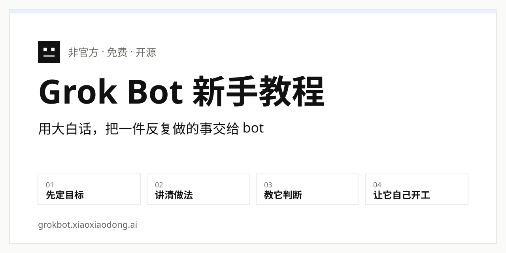

<div align="center">

# Grok Bot 新手教程

**中文** · [English](./README.en.md)

### Grok Bot 什么都能做。难的是，你得会把一件事交出去。

这是一个非官方的免费教程，用大白话讲怎么把你反复做的事交给 [Grok Bot](https://x.ai/bot)。<br>主线跟着 poteto 的文章 [Automate Anything with Grok Bot](https://x.com/poteto/status/2123159537016533493)，每条事实都对照过官方文档。

**[第一次用：新手入门三课 →](https://grokbot.xiaoxiaodong.ai/start/1-goal/)**　·　**[已经在用：完整教程 8 步 →](https://grokbot.xiaoxiaodong.ai/guide/0-what/)**

<sub>非官方 · 免费 · 开源 · 中文和英文</sub>


</div>

<p align="center">
  
</p>

## 😵 为什么要学

Grok Bot 有自己的电脑：能上网、点按钮、连上你常用的应用，还能按时间自己开工。

作者 poteto 觉得，很多人没把它用足，因为会自动化本身就是一门不好学的手艺。不是 bot 做不到，是还没学会怎么把一件事讲清楚、交出去。

## ✨ 这个教程怎么帮你

- **说人话。** 不讲术语，先让你动手，再讲为什么。
- **一条路走到底。** 新手入门三课做完，你就有一个按时替你干活的 bot。
- **按钮名和你屏幕上一样。** 中文页写的是 app 中文界面上的字，括号里给英文。
- **每条事实都有出处。** 来自作者的文章或[官方文档](https://docs.x.ai/grok-bot)，页面里附链接。

## 🧭 它是怎么干活的

作者把自动化拆成四步，本站的主线就照这个顺序走：

1. **先定目标。** 说清这件事最后要得到什么。填表、发邮件只是路上的一步，不是目标。
2. **讲清做法。** 把你平时怎么做一口气说给它听，让它先复述，你确认了再开工。
3. **教它判断。** 你做事时不用想的那些判断，它也要知道：两处信息对不上信哪个，怎样才算做完。
4. **让它自己开工。** 结果对了，设成例行任务，按时间或者等某件事发生就自动做。

## ⚡ 三分钟上手

1. 从 [x.ai/bot](https://x.ai/bot) 下载 Grok Bot，打开后点 **登录**（Sign in）。需要一个包含 Grok Bot 的套餐，比如 The X Subscription 的 Premium、Super 或 Ultra。
2. 点侧边栏最上面的 **+**（**新建 Bot**），名字填 `Potato`，点 **创建**。
3. 发给它：

```text
你好 Potato，这是我想交给你负责的目标，请记住它：
【最后要得到：……　这是为了：……】
请根据这个目标，给自己起一个名字，再选一张头像。
```

接下来怎么把做法讲给它、怎么设成按时做，见[新手入门第 3 课](https://grokbot.xiaoxiaodong.ai/start/3-hand-over/)。

## 📚 网站上有什么

- **[新手入门](https://grokbot.xiaoxiaodong.ai/start/1-goal/)**：三课，从想清楚目标到它按时替你做一件事。
- **[完整教程](https://grokbot.xiaoxiaodong.ai/guide/0-what/)**：8 步，连应用、让它自己变好、例行任务、一队 bot 和 Dr Eggbot。
- **[How-to](https://grokbot.xiaoxiaodong.ai/howto/)**：15 篇，晨间简报、收件箱、预约、评价、会议纪要这些具体的活，还有审批、登录和用量。
- **[Wiki](https://grokbot.xiaoxiaodong.ai/wiki/)**：17 个概念，一句话 → 打个比方 → 在 Grok Bot 里 → 常见误区。
- **[常见问题](https://grokbot.xiaoxiaodong.ai/faq/)**：套餐、界面语言、它会不会替你花钱发消息、卡住了怎么办。

## 💻 本地运行

```bash
npm install
npm run dev        # http://localhost:4430
npm run build      # 输出到 dist/
```

写作规矩、资料来源和同步官方文档的脚本，见 [docs/MAINTAINING.md](docs/MAINTAINING.md)。

## 🙌 致谢

- [poteto](https://x.com/poteto) 的文章 [Automate Anything with Grok Bot](https://x.com/poteto/status/2123159537016533493)，本站主线的思路和例子都来自它。
- [Grok Bot 官方文档](https://docs.x.ai/grok-bot)，功能、按钮和套餐以它为准。
- 网站骨架沿用 [pstack 新手教程](https://github.com/nevertoday/xxd-pstack)，界面用小小东 UI Kit。

## ⚠️ 非官方

本站和 xAI、Cursor 都没有关系，不代表官方说法。Grok Bot 是其所有者的商标。功能和套餐会变，以[官方文档](https://docs.x.ai/grok-bot)为准。

## 📄 许可

代码用 MIT 许可，见 [LICENSE](LICENSE)。
