<div align="center">

# Grok Bot 新手教程

**中文** · [English](./README.en.md)

### 如何爽用 Grok Bot：思路决定出路

在 SpaceX 做 Grok Bot 的工程师 poteto 写过一篇长文，讲自己怎么把事情交给 bot。<br>这个教程把它讲成三节课，你跟着做一遍，就有一个每周替你干活的 bot。

**[从第 1 课开始 →](https://grokbot.xiaoxiaodong.ai/start/1-goal/)**　·　**[已经在用了，看完整教程 →](https://grokbot.xiaoxiaodong.ai/guide/0-what/)**

<sub>非官方 · 免费 · 开源 · 中文和英文</sub>

</div>

<p align="center">
  
</p>

## 你可能已经试过

装好 Grok Bot，你让它查了点东西、写了段文案，它答得挺好。可到了周五，你还是自己翻邮件、抄数字、做幻灯片，跟没装一样。

问题不在它。聊天的 AI 回你一段话，剩下的还得你来做；Grok Bot 的 bot 有一台云端电脑，能开应用、上网、整理文件，还能到点自己开工，真的把事做完。差的只是一步：你得会把事情交出去。

<p align="center">
  
</p>

## 交出去的诀窍，一个苹果派就能讲明白

poteto 在文章开头说，自动化其实是一种思考方式，谁都学得会。它只有两部分：目标和过程。

烤一个苹果派，派是目标；买苹果、和面、包好、烤熟、放凉，是过程。很多人交给 bot 的是过程里的某一步，比如「帮我发封邮件」，于是 bot 也就只会发邮件。先说清楚你要的那个「派」，它才能替你把一整套过程接过去，甚至找到更省事的做法。

<p align="center">
  
</p>

## 三节课，跟着做就会

不用会写代码，也不用先学一堆名词。一节课只做一件事，做完你手里就多一样东西。

<p align="center">
  
</p>

1. **[写下一句话](https://grokbot.xiaoxiaodong.ai/start/1-goal/)**：想一件你常做的事，写下你真正要的结果。
2. **[建一个 Potato](https://grokbot.xiaoxiaodong.ai/start/2-first-bot/)**：装好 Grok Bot，建一个 bot，把这句话交给它。
3. **[交出一件事](https://grokbot.xiaoxiaodong.ai/start/3-hand-over/)**：把你平时怎么做讲给它听，看它做对一次，再让它每周自己做。

## 等不及的话，现在就试一句

装好 Grok Bot（从 [x.ai/bot](https://x.ai/bot) 下载，需要一个包含 Grok Bot 的套餐，比如 The X Subscription 的 Premium、Super 或 Ultra），点侧边栏最上面的 **+**（**新建 Bot**），名字填 `Potato`，然后发给它：

```text
你好 Potato，这是我想交给你负责的目标，请你记住：
我想每周一开会前，大家手里都有一份讲清这周进展的幻灯片，好让会上少念数字，多花时间做决定。
请照着这个目标，给自己起个名字，再选一张头像。
```

把中间那句换成你自己的事就行。接下来怎么把你的做法讲给它，见[第 3 课](https://grokbot.xiaoxiaodong.ai/start/3-hand-over/)。

## 已经在用了？

- **[完整教程](https://grokbot.xiaoxiaodong.ai/guide/0-what/)**：8 步，照着 poteto 那篇文章往深里讲：教它你怎么判断、连上你的应用、让它自己找反馈变好、到点自己开工，最后让几个 bot 分工合作。
- **[How-to](https://grokbot.xiaoxiaodong.ai/howto/)**：15 篇具体的活，晨间简报、收件箱、客人预约、顾客评价、会议纪要……还有哪些事要它先问你、登录怎么交给它、用量怎么算。
- **[Wiki](https://grokbot.xiaoxiaodong.ai/wiki/)** 和 **[常见问题](https://grokbot.xiaoxiaodong.ai/faq/)**：遇到不懂的词、拿不准的事，来这里查。

## 这个教程从哪来

主线来自 [poteto](https://x.com/poteto) 的文章 [Automate Anything with Grok Bot](https://x.com/poteto/status/2123159537016533493)。作者在 SpaceX 做 Grok Bot，之前在 Cursor，也是 React Compiler 核心团队的成员。功能、按钮和套餐，每一条都对照过 [Grok Bot 官方文档](https://docs.x.ai/grok-bot)；中文页上的按钮名，照的是 Grok Bot 中文界面上的字。

这是一个非官方的学习站，和 xAI、SpaceX、Cursor 都没有关系，也不代表他们的说法。Grok Bot 是其所有者的商标。功能和套餐会变，以官方文档为准。

## 本地运行

```bash
npm install
npm run dev        # http://localhost:4430
npm run build      # 输出到 dist/
```

写作规矩、资料来源和同步官方文档的脚本，见 [docs/MAINTAINING.md](docs/MAINTAINING.md)。网站骨架沿用 [pstack 新手教程](https://github.com/nevertoday/xxd-pstack)，界面用小小东 UI Kit。代码用 MIT 许可，见 [LICENSE](LICENSE)。
