<div align="center">

# Grok Bot para iniciantes

[中文](./README.md) · [English](./README.en.md) · [日本語](./README.ja.md) · [한국어](./README.ko.md) · [Español](./README.es.md) · **Português** · [Français](./README.fr.md) · [Deutsch](./README.de.md) · [Русский](./README.ru.md) · [العربية](./README.ar.md)

### Aproveite ao máximo o Grok Bot. Tudo começa pelo jeito como você pensa.

poteto, que desenvolve o Grok Bot na SpaceX, escreveu um artigo longo sobre como passar trabalho para bots.<br>Este guia transforma o artigo em três lições curtas. Siga uma vez e você terá um bot fazendo um trabalho para você toda semana.

**[Comece pela lição 1 →](https://grokbot.xiaoxiaodong.ai/pt/start/1-goal/)**　·　**[Já usa? O guia completo (em inglês) →](https://grokbot.xiaoxiaodong.ai/en/guide/0-what/)**

<sub>Não oficial · gratuito · código aberto · 10 idiomas</sub>

</div>

<p align="center">
  
</p>

## Você provavelmente já tentou isto

Você instalou o Grok Bot, pediu que ele pesquisasse algo ou escrevesse umas linhas, e ele se saiu bem. Aí chegou a sexta-feira, e você ainda estava vasculhando e-mails, copiando números e montando os slides por conta própria.

O problema não é o bot. Uma IA de chat entrega uma resposta e deixa o resto com você. Um bot do Grok Bot tem um computador na nuvem: ele pode abrir apps, navegar, organizar arquivos e começar em um horário marcado, então consegue terminar o trabalho de verdade. O que falta é saber como passar o trabalho para ele.

<p align="center">
  
</p>

## O truque cabe num jantar

poteto abre o artigo dizendo que automação é, na verdade, um jeito de pensar que qualquer pessoa pode aprender. Ela tem duas partes, um objetivo e um processo.

Pense no jantar. A comida na mesa é o objetivo. Fazer as compras, lavar, picar e cozinhar são o processo. A maioria das pessoas passa para o bot um passo só do processo, como “envie este e-mail”, e aí o bot só envia e-mails. Fale primeiro do jantar, e ele pode assumir o processo inteiro, e talvez encontrar um caminho mais fácil, do mesmo jeito que, num dia puxado, pedir delivery também põe o jantar na mesa.

<p align="center">
  
</p>

## Três lições, uma coisa de cada vez

Você não precisa programar nem aprender um monte de termos antes. Cada lição faz uma coisa só, e você sai dela com algo novo.

<p align="center">
  
</p>

1. **[Diga o que você quer](https://grokbot.xiaoxiaodong.ai/pt/start/1-goal/)**: escolha algo que você faz com frequência e escreva umas frases simples sobre o que te incomoda e qual resultado você quer.
2. **[Crie o Potato](https://grokbot.xiaoxiaodong.ai/pt/start/2-first-bot/)**: instale o Grok Bot, crie um bot e entregue a ele o que você escreveu.
3. **[Passe um trabalho](https://grokbot.xiaoxiaodong.ai/pt/start/3-hand-over/)**: conte como você faz o trabalho, veja como ele acerta uma vez e depois deixe que ele faça toda semana.

## Não aguenta esperar? Teste uma mensagem agora

Instale o Grok Bot pelo [x.ai/bot](https://x.ai/bot) (você precisa de um plano que o inclua, como Premium, Super ou Ultra na The X Subscription), clique em **+** (**Novo Bot**, ou New Bot se o seu app estiver em inglês) no alto da barra lateral, dê o nome `Potato` e envie:

```text
Oi, Potato! De agora em diante, esse trabalho é seu. Guarda bem:
Toda sexta à tarde eu fico garimpando o chat e os documentos para montar o relatório semanal, e odeio isso. Faz um rascunho do desta semana no mesmo formato do da semana passada, que eu dou uma ajeitada e entrego. Assim a minha sexta à tarde fica livre.
Com base nisso, escolhe um nome e uma imagem para você.
```

Troque o miolo da mensagem pelo seu próprio trabalho. Para explicar como você faz o trabalho, veja a [lição 3](https://grokbot.xiaoxiaodong.ai/pt/start/3-hand-over/).

## Já usa?

- **[O guia completo](https://grokbot.xiaoxiaodong.ai/en/guide/0-what/)** (em inglês): oito passos que vão mais fundo seguindo o artigo de poteto. Você ensina como você julga, conecta os seus apps, deixa que ele aprenda com o feedback, coloca-o para rodar em um horário e divide o trabalho entre uma equipe de bots.
- **[How-to](https://grokbot.xiaoxiaodong.ai/en/howto/)** (em inglês): 15 trabalhos reais, como um resumo toda manhã, a sua caixa de entrada, os agendamentos de clientes, as avaliações ou os resumos de reunião, além do que ele deve perguntar primeiro, como passar os seus logins para ele e como funciona o uso.
- **[Wiki](https://grokbot.xiaoxiaodong.ai/en/wiki/)** e **[perguntas frequentes](https://grokbot.xiaoxiaodong.ai/en/faq/)** (em inglês): para uma palavra que você não conhece ou uma dúvida que ainda não está clara.

## De onde vem isto

O guia segue o artigo [Automate Anything with Grok Bot](https://x.com/poteto/status/2123159537016533493) de [poteto](https://x.com/poteto). Quem o escreveu desenvolve o Grok Bot na SpaceX, trabalhou antes no Cursor e faz parte da equipe principal do React Compiler. Cada recurso, botão e plano é conferido com a [documentação oficial do Grok Bot](https://docs.x.ai/grok-bot), e os nomes dos botões nas páginas em chinês e em português correspondem à interface do app nesse idioma.

Este é um guia não oficial, sem relação com xAI, SpaceX ou Cursor, e não fala em nome deles. Grok Bot é uma marca do seu proprietário. Recursos e planos mudam, então a referência é a documentação oficial.

## Rodar localmente

```bash
npm install
npm run dev        # http://localhost:4430
npm run build      # saída em dist/
```

As regras de escrita, as fontes e o script que sincroniza a documentação oficial estão em [docs/MAINTAINING.md](docs/MAINTAINING.md). A base do site vem do [guia pstack para iniciantes](https://github.com/nevertoday/xxd-pstack), com o Xiaoxiaodong UI Kit. O código tem licença MIT; veja [LICENSE](LICENSE).
