<div align="center">

# Grok Bot для начинающих

[中文](./README.md) · [English](./README.en.md) · [日本語](./README.ja.md) · [한국어](./README.ko.md) · [Español](./README.es.md) · [Português](./README.pt.md) · [Français](./README.fr.md) · [Deutsch](./README.de.md) · **Русский** · [العربية](./README.ar.md)

### Как взять от Grok Bot всё. Начинается это с того, как вы думаете.

У poteto из команды Grok Bot в SpaceX есть длинный пост о том, как поручать работу ботам.<br>Это руководство превращает его в три коротких урока. Пройдите их один раз, и у вас будет бот, который каждую неделю делает за вас одну работу.

**[Начать с урока 1 →](https://grokbot.xiaoxiaodong.ai/ru/start/1-goal/)**　·　**[Уже пользуетесь? Полное руководство (на английском) →](https://grokbot.xiaoxiaodong.ai/en/guide/0-what/)**

<sub>Неофициально · бесплатно · открытый код · 10 языков</sub>

</div>

<p align="center">
  
</p>

## Наверное, вы это уже пробовали

Вы установили Grok Bot, попросили что-то найти или набросать пару строк, и он справился. А потом наступила пятница, и вы снова сами разбирали почту, копировали цифры и собирали слайды.

Дело не в боте. ИИ в чате даёт вам ответ, а остальное оставляет вам. У бота в Grok Bot есть компьютер в облаке: он может открывать приложения, ходить по сайтам, раскладывать файлы и запускаться по расписанию, так что он действительно способен довести дело до конца. Не хватает одного: умения передать ему работу.

<p align="center">
  
</p>

## Весь секрет умещается в яблочном пироге

Пост poteto начинается с мысли, что автоматизация на самом деле способ думать, и научиться ему может каждый. У неё две части: цель и процесс.

Когда вы печёте яблочный пирог, пирог и есть цель. Купить яблоки, замесить тесто, собрать, испечь и остудить — это процесс. Большинство отдаёт боту один шаг процесса, например «отправь это письмо», и бот только и делает, что отправляет письма. Расскажите ему сначала про пирог, и он сможет взять на себя весь процесс, а может, и найдёт способ проще.

<p align="center">
  
</p>

## Три урока, по одному делу за раз

Не нужно ни писать код, ни заранее учить кучу терминов. Каждый урок делает одно дело, и после него у вас появляется что-то новое.

<p align="center">
  
</p>

1. **[Напишите одно предложение](https://grokbot.xiaoxiaodong.ai/ru/start/1-goal/)**: выберите дело, которое делаете часто, и запишите результат, который вам на самом деле нужен.
2. **[Создайте Potato](https://grokbot.xiaoxiaodong.ai/ru/start/2-first-bot/)**: установите Grok Bot, создайте бота и дайте ему это предложение.
3. **[Передайте работу](https://grokbot.xiaoxiaodong.ai/ru/start/3-hand-over/)**: расскажите ему, как вы делаете эту работу, посмотрите, как он один раз сделает её правильно, и пусть дальше работает каждую неделю.

## Не терпится? Отправьте одно сообщение прямо сейчас

Установите Grok Bot с [x.ai/bot](https://x.ai/bot) (нужен тариф, в который он входит, например Premium, Super или Ultra в The X Subscription), нажмите **+** (**Новый Bot**) вверху боковой панели, назовите бота `Potato` и отправьте:

```text
Привет, Potato! Хочу поручить тебе вот такую цель. Запомни её, пожалуйста:
Я хочу к каждой понедельничной планёрке готовые слайды с итогами недели для всех, чтобы мы меньше зачитывали цифры вслух и больше решали.
Исходя из этой цели, выбери себе имя и картинку.
```

Замените среднюю строку своим делом. Чтобы рассказать ему, как вы делаете работу, загляните в [урок 3](https://grokbot.xiaoxiaodong.ai/ru/start/3-hand-over/).

## Уже пользуетесь?

- **[Полное руководство](https://grokbot.xiaoxiaodong.ai/en/guide/0-what/)** (на английском): восемь шагов, которые идут глубже вслед за постом poteto: научить его тому, как вы решаете, подключить приложения, дать ему учиться на отзывах, работать по расписанию и разделить работу между командой ботов.
- **[How-to](https://grokbot.xiaoxiaodong.ai/en/howto/)** (на английском): 15 настоящих задач, от утренней сводки, почты и записи клиентов до отзывов и итогов встреч, а ещё что он должен сначала у вас спросить, как передать ему свои логины и как устроено использование.
- **[Wiki](https://grokbot.xiaoxiaodong.ai/en/wiki/)** и **[частые вопросы](https://grokbot.xiaoxiaodong.ai/en/faq/)** (на английском): если встретилось незнакомое слово или есть вопрос, в котором вы не уверены.

## Откуда всё это

Руководство следует посту [poteto](https://x.com/poteto) [Automate Anything with Grok Bot](https://x.com/poteto/status/2123159537016533493). Автор делает Grok Bot в SpaceX и входит в основную команду React Compiler, а прежнее место работы автора — Cursor. Каждая функция, кнопка и тариф сверены с [официальной документацией Grok Bot](https://docs.x.ai/grok-bot); на страницах на любом языке названия кнопок совпадают с интерфейсом приложения на этом языке.

Это неофициальное руководство, никак не связанное с xAI, SpaceX или Cursor, и оно не выступает от их имени. Grok Bot — товарный знак своего владельца. Функции и тарифы меняются, так что ориентируйтесь на официальную документацию.

## Запустить у себя

```bash
npm install
npm run dev        # http://localhost:4430
npm run build      # результат в dist/
```

Правила написания, источники и скрипт, который синхронизирует официальную документацию, описаны в [docs/MAINTAINING.md](docs/MAINTAINING.md). Оболочка сайта взята из [pstack Beginner's Guide](https://github.com/nevertoday/xxd-pstack), интерфейс собран на Xiaoxiaodong UI Kit. Код распространяется по лицензии MIT, подробности в [LICENSE](LICENSE).
